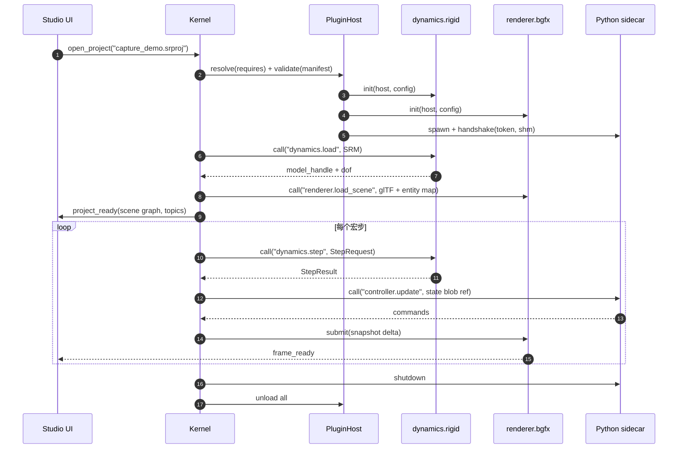

# 01 总体架构设计

> 项目代号：**SRSP**（Space Robot Simulation Platform，空间机器人仿真平台）
> 文档版本：0.1（架构基线）｜状态：评审草案｜最后更新：2026-10-20

---

## 1. 定位、边界与假设

### 1.1 产品定位

SRSP 是一套面向**空间机器人**（在轨服务、目标捕获、舱外装配、巡视探测、地面遥操作训练）的**桌面级可视化仿真平台**。它以"平台 + 插件"的方式集成机器人模型、动力学求解器、空间环境、传感器模型、可视化引擎与控制器，支持从快速原型到高保真验证的多种使用强度。

### 1.2 设计目标（按优先级）

| 编号 | 目标 | 可验证的判据 |
|---|---|---|
| G1 | **可插拔**：模型、动力学、环境、渲染等皆为插件，可动态装载/替换 | 同一场景在 3 个不同动力学插件间切换，仅改配置，不改代码 |
| G2 | **语言无关**：组件可用 C/C++、Rust、Python、C#、Java、MATLAB 等实现 | 至少有 1 个非 C++ 插件（Python 边车）通过一致性测试 |
| G3 | **跨平台**：Windows 10/11 与 Linux 同源构建、同源打包 | CI 在 Windows/Linux 构建矩阵上构建并跑通冒烟用例 |
| G4 | **确定性可重放**：同一输入产生同一位序列，支持录制/回放/回归 | 录制回放 10 分钟后状态哈希与原始运行一致 |
| G5 | **可视化优先**：轨道尺度场景、地球/星空/光照、传感器成像 | 1080p 主视口 60 fps；3 路 640×480 相机 30 Hz |
| G6 | **工程可交付**：MSYS2 + VSCode 一键环境，安装包可离线部署 | 干净虚拟机 30 分钟内完成安装并跑通示例 |
| G7 | **可演进**：契约稳定、插件生态可扩展、内核可拆分为服务 | 1.x 期间 ABI 不破坏；可选 `srspd` 远程内核模式 |

### 1.3 v1.0 的非目标（明确不做，避免范围蔓延）

- 分布式集群并行仿真、云端多用户协同编辑；
- 硬实时（μs 级抖动）与 RTOS 部署（保留 HIL 接口设计，v1 只做软实时）；
- 流体、热、结构有限元的强耦合（仅预留 `force` 扩展点）；
- 通用游戏引擎能力（动画、材质编辑器、关卡编辑器）；
- 移动端 / Web 端完整编辑器（Web 仅做查看与远程操作）；
- **GPU 并行强化学习训练平台**：不与 Isaac/MJX 竞争训练吞吐；仅保留数据互操作（MJCF/MCap 导入导出、MuJoCo 边车插件），推理与训练属于外部生态。

### 1.4 关键假设

| 假设 | 影响 | 若不成立 |
|---|---|---|
| 单机仿真，模型规模 ≤ 200 刚体、≤ 2000 状态量 | 单进程 + 单 sim 线程即可满足 | 需引入多线程动力学 / 分布式内核 |
| 团队 5–8 人，1.0 周期 9–12 个月 | 里程碑与人力安排 | 压缩 v1 范围（先做刚性多体 + 基础环境） |
| 目标机器有独立 GPU（Vulkan/DX11/GL 4.1 任一） | 默认渲染器用 bgfx | 降级到 Qt Quick 3D 或纯软件视图 |
| 部署环境可能离线/涉密内网 | 依赖必须可离线打包，禁止运行时下载 | 需额外搭建内网制品库 |
| 用户具备航天动力学基础 | UI 直接暴露 ECI/RIC、四元数等概念 | 需增加向导式场景模板 |

---

## 2. 架构原则

1. **契约先行（Contract First）**：先冻结数据模式与能力接口，再写实现；插件与内核只通过版本化契约耦合。
2. **内核最小化**：内核只负责调度、注册、时间、坐标系、数据总线、插件生命周期与故障处理，不含任何领域算法。
3. **数据与算法分离**：模型（SRM）、状态、场景是数据；动力学、环境、渲染是消费/生产这些数据的算法插件。
4. **进程边界即故障边界**：不受信任或运行时复杂的插件放入边车进程；进程内只允许稳定 ABI 的 C/C++/Rust 插件。
5. **同一语义，两种传输**：进程内 C ABI 与进程间 gRPC 承载完全相同的消息与方法语义，避免"两套 API"。
6. **确定性优先于便利性**：仿真线程内禁止墙钟、哈希遍历、无序并行归约；随机数只来自内核注入的确定性流。
7. **渲染与仿真解耦**：仿真步进不被渲染帧率阻塞；渲染消费最新快照，允许丢帧与插值。
8. **一切可观测**：每个宏步、每次插件调用都可打点；日志、指标、录像是同一套事件模型的不同投影。

---

## 3. 分层视图

```
┌──────────────────────────────────────────────────────────────────────────┐
│ L3 应用层                                                                │
│   srsp-studio（Qt 桌面）   srsp-cli（无头/批处理）   srsp-web（远程查看）  │
│   Python SDK   MATLAB SDK   CI 测试驱动                                   │
└───────────────┬──────────────────────────────────┬───────────────────────┘
                │ 进程内 API / gRPC / WebSocket     │
┌───────────────▼──────────────────────────────────▼───────────────────────┐
│ L2 平台内核 libsrsp（C++20）                                              │
│   Runtime/Scheduler   Service Registry   Data Bus   Frame Graph           │
│   Time Service        Package Manager    Snapshot/Replay   Diagnostics    │
│   Plugin Host（in-proc loader + sidecar supervisor）                      │
└───────┬───────────────────────────────────────────────┬──────────────────┘
        │ C ABI v1（dlopen / LoadLibrary）               │ gRPC + 共享内存
┌───────▼──────────────────────────────┐   ┌────────────▼──────────────────┐
│ L1a 进程内插件                        │   │ L1b 边车插件                   │
│  model.*  dynamics.*  env.*           │   │  pybridge（Python）            │
│  sensor.* render.* control.* io.*     │   │  unity-renderer / matlab / jvm │
└──────────────────────────────────────┘   └───────────────────────────────┘
┌──────────────────────────────────────────────────────────────────────────┐
│ L0 契约层（api/）：C ABI 头文件 · Protobuf · JSON Schema · glTF 扩展 · 版本 │
└──────────────────────────────────────────────────────────────────────────┘
```

**依赖方向**：L3 → L2 → L0；L1 插件只依赖 L0。禁止插件反向依赖内核内部头文件（由 CMake 目标隔离 + 头文件安装白名单保证）。

### 3.1 为什么"内核 + 插件"而不是"框架 + 模块"

- 模块是编译期链接，插件是运行期发现：后者允许第三方在不重新编译平台的情况下扩展能力，也允许同一场景切换实现（例如刚性动力学 ↔ MuJoCo）。
- 插件有独立版本号、独立发布节奏、独立许可证，便于高校/院所合作方只交付自己的算法。
- 故障隔离与资源配额只能在进程/动态库边界上实施。

---

## 4. 进程与部署视图

### 4.1 三种候选形态

| 形态 | 描述 | 优点 | 缺点 | 结论 |
|---|---|---|---|---|
| A. 单进程 | Studio = UI + 内核 + 默认插件 | 延迟最低、实现最简单、调试方便 | C++ 插件崩溃拖垮 UI；难以无头复用 | **v1.0 默认** |
| B. UI/内核分离 | `srspd` 内核进程 + Studio 客户端 | 崩溃隔离、天然支持远程与无头、便于集群 | 多一层 IPC，窗口/渲染归属需设计 | v1.x 可选模式 |
| C. 全隔离 | 内核 + 每插件一进程 | 最强隔离 | 通信开销大、调试复杂、打包庞大 | 仅对不受信任插件启用 |

**决策**：v1.0 采用形态 A，但**内核对外 API 一律按"可跨进程"设计**（gRPC service 定义与进程内 C ABI 同构），保证形态 B 是部署选项而非重写。渲染器与 UI 同进程，便于原生窗口嵌入与低延迟交互。

### 4.2 典型部署

```
单机桌面（默认）
  srsp-studio.exe
    ├─ Qt UI 线程
    ├─ Sim 线程（内核调度）
    ├─ Render 线程（bgfx，主视口 + 传感器离屏视图）
    ├─ IO 线程（MCAP 录制、gRPC server）
    └─ 子进程：pybridge（Python 控制器/脚本）、可选 unity-renderer

无头/批处理
  srsp-cli --scenario capture.json --duration 600 --record run.mcap
    └─ 同一内核库，无 Qt，无渲染（或 renderer.null）

远程/训练
  srspd（Linux 服务器，无头） ← gRPC/WebSocket → srsp-web（浏览器）/ 轻客户端
```

### 4.3 线程模型

| 线程 | 归属 | 职责 | 约束 |
|---|---|---|---|
| UI | Qt 主线程 | 界面、面板、拾取请求 | 不得直接触碰仿真状态，只能发命令/取快照 |
| Sim | 内核 | 事件处理、步进、发布快照 | 唯一可修改仿真状态的线程 |
| Render | 渲染插件 | 消费快照、绘制、离屏成像 | 只读快照；不得阻塞 Sim |
| IO | 内核 | 录制、gRPC/WebSocket 服务 | 通过无锁队列与 Sim 交互 |
| Sidecar | 子进程 | 插件自身逻辑 | 通过 gRPC + 共享内存通信 |

**调用规则**：插件方法默认只在 Sim 线程被调用；清单 `entry.thread_safe` 中列出的方法可被 IO 线程并发调用（例如查询元数据）。任何插件不得自行创建长期线程去读写仿真状态。

---

## 5. 运行时视图

### 5.1 宏步调度循环

```
while (running):
    t_next = t + dt
    events = event_queue.pop_until(t_next)          # 确定性排序：t, priority, seq
    dispatch(events)

    for sensor in sensors_due(t):                   # 采样时刻 = t
        sensor.sample(state, t) -> publish(topic, blob)

    for controller in controllers_due(t):
        controller.update(state, t) -> commands     # 写入命令总线

    forces = zero
    for provider in force_providers:                # 顺序固定 = 注册序号
        provider.accumulate(state, t, env, forces)

    dynamics.step(state, t, dt, commands, forces)   # 插件内部可子步
    t = t_next

    snapshot = state.freeze()                       # 双缓冲 / 不可变视图
    bus.publish("sim.state", snapshot)
    recorder.offer(snapshot)                        # 非阻塞
    renderer.offer(snapshot)                        # 非阻塞，允许丢帧
```

关键点：

- **事件驱动 + 固定步长**：默认 `dt = 1 ms`，可在 0.1–10 ms 配置；变步长由动力学插件在内部子步实现，对外仍以宏步汇报。
- **多速率**：传感器/控制器按 `rate_hz` 对齐宏步（只允许整数分频）；渲染按帧率独立。
- **快照不可变**：Sim 线程产出只读快照（引用计数），渲染/录制/网络各持一份，避免锁。
- **背压**：录制队列满时按策略丢弃低优先级话题并计数告警，绝不阻塞 Sim。

### 5.2 一次"加载场景并步进"的时序



### 5.3 数据流与所有权

```
                 ┌───────────────┐
   SRM 模型 ───▶ │ dynamics 插件 │ ───▶ 状态(Arrow) ──┬──▶ 渲染器
                 └───────────────┘                    ├──▶ 录制器(MCAP)
                        ▲                             ├──▶ 传感器
   力模型/环境 ─────────┘                             └──▶ UI/网络
```

- 模型由 `model.importer` 解析为 SRM 后交给内核；内核持有只读副本，按引用传给动力学/渲染。
- 状态由动力学插件产出，内核负责发布；其他插件只读。
- 命令由控制器产出，动力学插件消费；命令带时间戳与有效期，过期丢弃。

---

## 6. 关键机制

### 6.1 服务注册与能力发现

内核维护两层注册表：

| 注册表 | 键 | 值 | 用途 |
|---|---|---|---|
| 插件表 | `plugin_id` | 清单、状态、进程信息 | 管理生命周期 |
| 能力表 | `capability@major` | 实现列表 + 优先级 + 约束 | 按能力解析依赖、支持多实现切换 |

场景文件不直接引用插件 ID，而引用**能力需求**（`srsp.dynamics/solver@>=1.0`）；由 `selection` 策略（优先级、用户固定、基准测试得分）选出实现。这样替换求解器不需要改场景。

### 6.2 时间与坐标系

- 时间：内核 `TimeService` 统一提供 TAI 纳秒 + 比例因子；支持实时/加速/单步/外部时钟四种模式；UTC↔TAI 使用内置闰秒表，TDB↔TT 使用简化周期项（详见 03 文档）。
- 坐标系：`FrameGraph` 管理 ECI(J2000)、ECEF(ITRF)、RIC（Radial-In-track-Cross-track，近距操作常用）、本体、关节、传感器、站点等；所有变换双精度，查询需带时刻。
- 单位：SI（m、kg、s、rad、N、N·m），角度一律弧度，四元数 `[x,y,z,w]`。

### 6.3 确定性

| 来源 | 措施 |
|---|---|
| 时间 | 仿真时间只由步长累加，不读墙钟 |
| 迭代顺序 | 全部按注册序号/实体 ID 排序，禁用 `unordered_map` 遍历 |
| 随机数 | 内核提供按 `(seed, entity_id, stream)` 派生的独立流 |
| 并行 | 力模型可并行计算，但按固定顺序归约；禁止浮点原子累加 |
| 编译 | 禁用 `-ffast-math`；固定 FP 收缩选项；记录编译器与 flags |
| 外部 | 边车插件必须实现 `checkpoint/restore`，重放时禁用其内部缓存 |

跨平台一致性目标：同一算法与顺序下相对误差 < 1e-9；**GPU 渲染与传感器图像不做跨驱动位级一致承诺**，仅同机同驱动内可复现，跨平台用图像相似度阈值。

### 6.4 故障处理

| 场景 | 策略 |
|---|---|
| 边车进程崩溃 | 看门狗检测 → 指数退避重启（默认 3 次）→ 从最近检查点恢复 → 仍失败则标记能力降级并告警 |
| 边车无响应 | 心跳超时（默认 2 s）→ 取消当前调用 → 重启 |
| 进程内插件崩溃 | 进程终止；启动时进入安全模式，禁用上次崩溃的插件并提示 |
| 插件返回错误 | 结构化错误码 + 诊断信息；调度器按 `fail_policy`（fail-fast / skip-step / degrade）处理 |
| 录制写满磁盘 | 停止录制并告警，仿真继续 |

### 6.5 可观测性

- 统一诊断模型：`severity + code + message + context + remedy`；
- 每个宏步记录：耗时分解（传感器/控制器/力模型/动力学/序列化）、状态哈希、事件数；
- Tracy 集成的帧/步剖析；可选 OpenTelemetry 导出（后续）；
- 日志分级 + 结构化 JSON 双输出，支持按插件过滤。

---

## 7. 质量属性目标

| 属性 | 指标（目标值，x86-64 / -O2） | 验证方式 |
|---|---|---|
| 动力学性能 | 100 刚体 + 30 关节，单步 ≤ 300 μs | 基准测试（Google Benchmark） |
| 插件开销 | 进程内单次调用 p99 ≤ 20 μs；边车单宏步 ≤ 1 ms | 微基准 + 端到端 |
| 渲染 | 1080p、2M 三角形、60 fps；4 视口不降主视口帧率 | GPU 计时查询 + 帧分析 |
| 启动 | 冷启动 ≤ 3 s，热启动 ≤ 1.5 s | 启动打点 |
| 内存 | 典型场景 ≤ 2 GB | 进程 RSS 采样 |
| 确定性 | 同平台同构建 10 分钟回放哈希一致 | 回归用例 |
| 稳定性 | 8 小时连续运行无内存增长（< 2%） | soak test |
| 可用性 | 边车崩溃后 ≤ 3 s 恢复或降级提示 | 故障注入 |

---

## 8. 架构决策摘要（ADR Index）

| ADR | 决策 | 主要理由 | 详见 |
|---|---|---|---|
| A01 | 内核 C++20，插件契约为纯 C ABI | 跨语言 FFI 成本最低，ABI 稳定可控 | 02 |
| A02 | 控制面 Protobuf，数据面 Arrow C Data Interface | 一个语义两种传输；零拷贝、生态成熟 | 02/03 |
| A03 | 进程内 + 边车双传输 | 性能与语言自由/隔离兼得 | 02 |
| A04 | 自定义模型 IR（SRM），URDF/SDF/MJCF 仅作导入器 | 空间机器人需要柔性、动量交换、推力器等扩展 | 03 |
| A05 | 场景用 glTF 2.0 + 自定义扩展 | 工具链成熟、可复用 DCC 资产 | 03 |
| A06 | 渲染器为插件，默认 bgfx | 多后端、可控管线、BSD 许可 | 04 |
| A07 | Python 不内嵌，作为边车 | 规避 MinGW/MSVC ABI 与 GIL 风险，可用完整生态 | 04/05 |
| A08 | 录制用 MCAP | 自描述、可索引、跨语言、Foxglove 可直接看 | 03/04 |
| A09 | Windows 用 MSYS2 UCRT64 原生工具链 | 满足约束、包生态完整、产物为原生 Win64 | 05 |
| A10 | 打包可重定位 runtime + `.srpkg` 插件包 | 离线部署、插件独立升级 | 06 |
| A11 | 内核对外暴露宿主侧 C API（`core_api.h`） | Rust CLI、Python SDK、Web 服务等非 C++ 应用可嵌入内核；与插件 ABI 同规则 | 02/api |
| A12 | Windows 多工具链：UCRT64-GCC 为主，UCRT64-Clang / CLANG64 / MSVC 为辅 | 第二编译器与 sanitizer 走 Clang（同 libstdc++ 可互链），CLANG64 仅作 libc++ 验证层；插件按 `os-arch-toolchain` 分发，跨工具链只允许 C ABI 加载或边车 | 02/05/06 |

---

## 9. 术语表

| 术语 | 含义 |
|---|---|
| SRM | Space Robot Model，平台自定义的机器人模型中间表示 |
| SRSP | 本项目代号；C API 前缀 `srsp_` |
| 能力（Capability） | 形如 `srsp.dynamics/solver@1` 的接口契约标识 |
| 宏步 | 调度器对外暴露的最小步进单位，默认 1 ms |
| 边车（Sidecar） | 独立进程运行的插件，通过 gRPC + 共享内存与内核通信 |
| 快照 | 某一时刻不可变的仿真状态视图（Arrow 表 + 元数据） |
| 降级 | 某项能力不可用时，平台以受限功能继续运行 |
| 场景 | 项目（plugins/config） + 模型 + 环境 + 初始状态 + 脚本的集合 |
