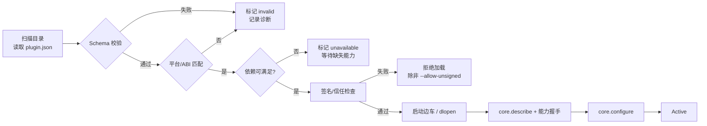

# 02 插件体系与接口契约

> 本文定义 SRSP 的插件模型、清单格式、C ABI、能力方法与边车协议。它是平台与所有插件之间的**唯一耦合面**。
> 契约版本：ABI 1.0 ｜ 状态：评审草案

---

## 1. 插件模型

### 1.1 插件是什么

插件是一个可独立分发、可动态装载的二进制或进程，向平台注册**一个或多个能力（Capability）**，并通过统一的方法调用面响应平台请求。

插件**不**直接链接内核；它只依赖：

- `api/include/srsp/plugin_api.h`（纯 C ABI，无第三方依赖）；
- `api/proto/`（控制面消息定义）；
- `api/schema/`（数据模式）；
- 可选：官方 SDK（C++ 封装、Python 边车框架）。

### 1.2 插件种类与能力

| 种类（kind） | 能力 ID | 典型实现 | 运行位置 |
|---|---|---|---|
| 模型导入 | `srsp.model/importer@1` | URDF/SDF/MJCF/自定义 CAD 转换 | 进程内或边车 |
| 动力学求解 | `srsp.dynamics/solver@1` | 自研刚性/柔性多体、Pinocchio、MuJoCo | 进程内（C++）/边车 |
| 力模型 | `srsp.dynamics/force@1` | 重力梯度、SRP、气动、推力器、柔性耦合 | 进程内 |
| 接触/捕获 | `srsp.dynamics/contact@1` | 冲量法、SDF、抓持约束 | 进程内 / 边车 |
| 空间环境 | `srsp.env/ephemeris@1`、`gravity`、`atmosphere`、`lighting` | SPICE、EGM2008、NRLMSISE-00、星空 | 进程内或边车 |
| 传感器 | `srsp.sensor/device@1` | IMU、星敏、相机、LiDAR、GNSS、F/T | 进程内 |
| 渲染器 | `srsp.render/renderer@1` | bgfx、Qt Quick 3D、three.js、Unity | 进程内或边车 |
| 控制器 | `srsp.control/controller@1` | PD、计算力矩、MPC、遥操作 | 进程内或边车（Python/MATLAB） |
| 记录/回放 | `srsp.io/recorder@1` | MCAP、Parquet | 进程内 |
| 界面面板 | `srsp.ui/panel@1` | Qt 面板、Web 面板 | 进程内 / Web |
| 脚本引擎 | `srsp.script/engine@1` | Python 边车、Lua（可选） | 边车 |

### 1.3 插件粒度原则

- **一个插件 = 一个可独立升级的交付单元**，可包含多个能力（例如"环境包"同时提供星历、重力、光照）。
- 同一能力允许多个实现共存，由选择策略决定激活哪一个。
- 插件之间**不得**直接调用；一切协作通过内核的数据总线或能力查询完成。

---

## 2. 插件清单（manifest）

每个插件根目录必须有 `plugin.json`，符合 `api/schema/plugin-manifest.schema.json`。

```json
{
  "schema": "srsp.plugin/1",
  "id": "org.srsp.env.spice",
  "name": "SPICE Ephemeris",
  "version": "0.3.1",
  "api": "1.0",
  "kind": ["environment"],
  "description": "基于 NAIF CSPICE 的星历、光照与 eclipse 计算",
  "vendor": { "name": "SRSP Team", "contact": "dev@example.org" },
  "license": "Apache-2.0",
  "transport": {
    "type": "inproc",
    "library": {
      "windows-x86_64": "bin/srsp_env_spice.dll",
      "linux-x86_64": "lib/libsrsp_env_spice.so"
    },
    "symbol": "srsp_plugin_query"
  },
  "capabilities": [
    { "name": "srsp.env/ephemeris", "version": "1.0", "alias": "ephemeris" },
    { "name": "srsp.env/lighting", "version": "1.0", "alias": "lighting" }
  ],
  "requires": ["srsp.frames@>=1.0 <2.0"],
  "optional_requires": ["srsp.env/atmosphere@^1.0"],
  "platforms": ["windows-x86_64", "linux-x86_64"],
  "permissions": ["filesystem.read:data/kernels", "log"],
  "config_schema": "schema/config.schema.json",
  "entry": { "init_timeout_ms": 5000, "thread_safe": ["core.describe"] }
}
```

字段说明（节选）：

| 字段 | 必填 | 说明 |
|---|---|---|
| `id` | 是 | 反向域名风格，全局唯一，发布后不可变 |
| `version` | 是 | SemVer 2.0；插件自身版本 |
| `api` | 是 | 所依赖的平台 ABI 主版本，`1.0` 表示兼容 ABI 1.x |
| `transport.type` | 是 | `inproc` / `sidecar` |
| `transport.library` | inproc 必填 | 按平台标签给出相对路径；标签为 `os-arch-toolchain`（如 `windows-x86_64-ucrt64`、`windows-x86_64-msvc`），旧式 `os-arch` 标签保留作别名，加载器按"最具体优先"解析；合法标签集见 `api/schema/plugin-manifest.schema.json` |
| `transport.command` | sidecar 必填 | 启动命令模板，支持 `${ENDPOINT}`、`${TOKEN}`、`${SHM}` |
| `capabilities[].name` | 是 | 能力 ID，含 `@` 前的主名 |
| `capabilities[].version` | 是 | 能力契约版本 |
| `capabilities[].alias` | 是 | 方法前缀，见 §5.1 |
| `requires` / `optional_requires` | 否 | 能力或平台服务依赖，支持 semver 区间 |
| `permissions` | 否 | 声明式权限，安装时展示，运行时强制 |
| `entry.thread_safe` | 否 | 允许非 Sim 线程并发调用的方法列表 |

> 平台服务（非插件提供）也以能力形式声明，例如 `srsp.frames@1`、`srsp.time@1`、`srsp.bus@1`，便于插件表达对内核功能的依赖。

---

## 3. 发现、安装与加载

### 3.1 搜索路径

按优先级：

1. `<project>/.srsp/plugins/`（项目私有，便于复现实验）
2. `%LOCALAPPDATA%\SRSP\plugins\` / `~/.local/share/srsp/plugins/`（用户级）
3. `<install>/plugins/`（随平台分发）
4. 环境变量 `SRSP_PLUGIN_PATH` 指定的额外目录（开发用，仅 `--dev` 模式生效）

### 3.2 装载流程



**安全模式**：上次崩溃涉及的插件记为 `quarantined`，启动时跳过并提示；用户可在插件管理器中解除。

### 3.3 依赖解析

- 依赖图节点 = 能力需求；边 = `requires`。
- 求解器按"最高版本优先 + 用户固定（pin）优先"选出实现；若冲突，回退到次优组合并给出解释。
- 拓扑排序决定 `init` 顺序，逆序 `shutdown`；检测到环直接拒绝该项目加载。
- `optional_requires` 只影响能力增强，不阻塞启动。

---

## 4. C ABI（进程内契约）

完整定义见 `api/include/srsp/plugin_api.h`。以下为规则与关键结构。

### 4.1 设计约束

| 约束 | 说明 |
|---|---|
| 纯 C | 仅 `stdint.h`/`stddef.h`；不得跨边界传递 STL、异常、RTTI、C++ 对象 |
| 版本化结构 | 每个结构首字段为 `uint32_t struct_size`，只允许尾部追加字段 |
| 调用约定 | `extern "C"` + 平台默认 C 调用约定；Windows 下不导出 C++ 符号 |
| 字符编码 | UTF-8，不含终止符，长度显式给出 |
| 内存所有权 | 入参由调用方持有；出参由被调方用 `host->alloc` 分配，调用方用 `host->free` 释放 |
| 异常 | 插件内部异常必须在边界处捕获并转为 `srsp_status` + `srsp_error` |
| 线程 | 除 `entry.thread_safe` 列出的方法外，仅 Sim 线程调用 |
| 位域与枚举 | 禁止位域；枚举保持固定 32 位表示 |
| 跨编译器布局 | 结构布局在 MSVC/GCC/Clang（x86-64）下必须一致，使不同工具链构建的宿主与插件可互相加载；由 `tests/abi/layout_static_assert.cpp` 在每次构建中强制（2026-10-22 已在 GCC 16.1、Clang 22.1.8（libstdc++/libc++）、MSVC 19.50 通过） |
| 插件自包含 | 插件必须静态链接其 C/C++ 运行库（MinGW `-static-libgcc -static-libstdc++`，MSVC `/MT`），否则跨工具链加载时因缺少 CRT 而失败 |

### 4.2 入口与生命周期

```c
SRSP_EXPORT const srsp_plugin_v1* SRSP_CALL srsp_plugin_query(
    uint32_t host_abi_major, const srsp_host_v1* host);
```

- 平台以 `host_abi_major = 1` 调用；插件若只支持其他主版本，返回 `NULL`。
- 返回的结构体是**静态常量**，生命周期直到进程结束；`self` 由插件在 `init` 中设置。
- `init` 只做轻量注册与配置解析；重型资源（星历内核、模型网格）应在首次业务调用时惰性加载，避免拖慢启动。

### 4.3 关键结构（摘录）

```c
typedef struct srsp_plugin_v1 {
  uint32_t struct_size;
  const char* id;          /* 与 manifest 一致 */
  const char* version;
  void* self;              /* 插件私有实例 */
  srsp_status (SRSP_CALL* init)(void* self, const srsp_host_v1* host,
                                srsp_str config_json, srsp_error* err);
  srsp_status (SRSP_CALL* call)(void* self, srsp_str method,
                                srsp_bytes request, srsp_buffer* response,
                                srsp_error* err);
  srsp_status (SRSP_CALL* checkpoint)(void* self, srsp_buffer* out, srsp_error* err);
  srsp_status (SRSP_CALL* restore)(void* self, srsp_bytes in, srsp_error* err);
  void (SRSP_CALL* shutdown)(void* self);
} srsp_plugin_v1;
```

### 4.4 Host 服务

平台通过 `srsp_host_v1` 向插件提供最小服务集：

| 服务 | 用途 |
|---|---|
| `log(level, msg)` | 结构化日志，自动带上插件 ID 与步号 |
| `time_tai()` | 当前仿真时间（TAI 秒），确定性 |
| `alloc/free` | 跨 DLL 堆边界安全的内存分配 |
| `publish(topic, payload, schema_hash)` | 向数据总线发布消息 |
| `shm_map/shm_unmap` | 映射平台预创建的共享内存段（大数组/图像） |

Host 结构同样版本化；插件在使用某字段前必须检查 `struct_size` 是否覆盖该字段的偏移。

### 4.5 错误模型

```c
typedef struct srsp_error {
  uint32_t struct_size;
  srsp_status code;
  const char* message;      /* 简短、面向用户 */
  const char* detail_json;  /* 可选，结构化上下文 */
} srsp_error;
```

`message`/`detail_json` 由被调方持有，有效期至下一次调用或 `shutdown`；调用方需要保留时必须复制。错误码语义、责任方与处理建议见 [`api/error_codes.md`](../api/error_codes.md)。

---

## 5. 能力方法与消息

### 5.1 方法命名

```
<alias>.<method>         例：dynamics.step、ephemeris.state
core.<method>            平台保留：describe / configure / ping / checkpoint / restore / stats
```

- 方法名是**稳定的字符串契约**，发布后只能新增，不能改名。
- 请求/响应均为 Protobuf 消息（`api/proto/srsp/v1/*.proto`），字段只增不改、不复用编号。
- 大数组不进入 Protobuf，使用 `BlobRef` 指向共享内存中的 Arrow 数据（见 03 文档 §5）。

### 5.2 保留方法

| 方法 | 请求 | 响应 | 说明 |
|---|---|---|---|
| `core.describe` | 空 | `PluginDescriptor` | 返回能力、版本、配置模式、限制 |
| `core.configure` | `ConfigRequest` | `Empty` | 幂等；可在暂停态重配 |
| `core.ping` | 空 | `PingReply` | 健康检查、返回当前步号 |
| `core.checkpoint` | 空 | `BlobRef`/bytes | 状态序列化 |
| `core.restore` | bytes | `Empty` | 与 checkpoint 配对 |
| `core.stats` | 空 | `StatsReply` | 内部计数器、耗时 |

### 5.3 核心能力契约

#### `srsp.dynamics/solver@1`

| 方法 | 语义 |
|---|---|
| `load(SrmBundle) → ModelInfo` | 解析模型，返回 `nq/nv/nbodies`、关节表、执行器表 |
| `unload()` | 释放模型 |
| `reset(StateInit)` | 设置初始状态（基座位姿/速度、关节角/角速度、轮速） |
| `step(StepRequest) → StepResult` | 推进 `dt`，消费命令与力模型贡献；可内部子步 |
| `get_state() → ArrowState` | 只读状态视图（零拷贝） |
| `set_state(ArrowState)` | 用于回放/热启动 |
| `mass_matrix() → Matrix` | `nv×nv`，列主序 |
| `bias_forces() → Vector` | 科氏/离心/重力项（若求解器自带重力） |
| `jacobian(JacobianRequest) → Matrix` | 指定 body/点/参考系 |
| `energy() → EnergyReport` | 动能、势能、轮动量 |
| `set_parameters(ParamPatch)` | 在线改质量、摩擦、增益（受 `supports_param_patch` 限制） |

**语义要求**：

- `step` 必须确定性：相同输入与状态产生相同输出（浮点环境一致前提下）。
- 必须接受外部力模型贡献的总广义力，不得自行重复计算已由 `force` 插件提供的项。
- 浮基机器人必须支持 6 自由度基座；`nq = 7 + Σ关节自由度`（四元数基座）或等价的 Lie 群表示，需在 `ModelInfo` 中声明约定。
- 接触由独立 `contact` 能力提供时，`step` 内需在约定子步调用其 `resolve`。

#### `srsp.dynamics/force@1`

| 方法 | 语义 |
|---|---|
| `describe() → ForceInfo` | 依赖的状态量、是否依赖环境、适用坐标系 |
| `accumulate(ForceRequest) → GeneralizedForces` | 返回 `nv` 维广义力（或等效力/力矩对） |

`ForceRequest` 包含时间、状态引用、环境引用（星历/重力/大气/光照的只读服务句柄）。力模型按注册顺序累加，插件不得修改状态。

#### `srsp.env/ephemeris@1`

| 方法 | 语义 |
|---|---|
| `bodies() → BodyList` | 可提供的天体/站点 |
| `state(EphemerisRequest) → EphemerisState` | 指定参考系下位置/速度、光行时 |
| `eclipse(EclipseRequest) → EclipseState` | 本影/半影因子、遮挡体 |

#### `srsp.render/renderer@1`

| 方法 | 语义 |
|---|---|
| `describe() → RendererInfo` | 后端、最大视口、支持的特性（阴影/后处理/离屏/Pick） |
| `create_surface(SurfaceDesc) → SurfaceHandle` | 绑定原生窗口（HWND / X11 window / 无窗口） |
| `load_scene(SceneBundle)` | glTF + 实体映射 + 材质覆盖 |
| `update(SceneDelta)` | 位姿、灯光、相机、覆盖层、选中态 |
| `render(RenderRequest)` | 绘制一帧；可异步 |
| `capture(CaptureRequest) → ImageRef` | 离屏成像（相机/深度/分割） |
| `pick(PickRequest) → PickResult` | 屏幕坐标 → 实体/关节 |
| `resize/destroy_surface/stats` | 生命周期与统计 |

**性能契约**：`update` 必须是非阻塞的；渲染线程可丢弃过期的 `SceneDelta`（以 `generation` 判断）。`capture` 允许 1–3 帧延迟，但必须返回该请求对应的仿真时刻。

#### `srsp.sensor/device@1`

| 方法 | 语义 |
|---|---|
| `describe() → SensorInfo` | 类型、量测维度、标称频率、噪声参数模式 |
| `configure(SensorConfig)` | 安装矩阵、量程、噪声种子、内参 |
| `sample(SampleRequest) → SensorFrame` | 输出数据 + 时间戳 + 状态标志（饱和/失效） |

传感器可以声明对 `render/renderer` 的依赖（相机、LiDAR），由内核注入渲染服务代理，禁止直接查找全局单例。

#### 其他能力

`srsp.model/importer@1`、`srsp.control/controller@1`、`srsp.io/recorder@1`、`srsp.ui/panel@1`、`srsp.script/engine@1` 的方法表在 M0 冻结时拆分为 `api/proto/srsp/v1/capabilities.proto`；当前以 04 文档的能力矩阵为准。

---

## 6. 版本与兼容策略

| 层级 | 版本载体 | 兼容规则 |
|---|---|---|
| 平台 ABI | `SRSP_ABI_MAJOR/MINOR` | 主版本必须相等；次版本向后兼容（只加字段/方法） |
| 能力契约 | `capability@major.minor` | 主版本变化 = 语义破坏；次版本只增不改 |
| 消息 | Protobuf 字段号 | 只增字段、不复用编号、不改变字段语义 |
| 数据模式 | `schema_id` + 内容哈希 | 内核按哈希校验；不匹配拒绝并提示升级插件 |
| 插件版本 | SemVer | 依赖区间求解；构建元数据不参与比较 |

**废弃流程**：标记 deprecated → 至少保留 2 个次版本 → 主版本移除；废弃期内新旧方法并存，内核发诊断告警。

---

## 7. 边车（Sidecar）协议

### 7.1 适用场景

- 非 C/C++ 语言实现（Python、Java、C#、MATLAB、Julia）；
- 需要强隔离或许可证隔离（Unity、商业求解器）；
- 不稳定/实验性插件，避免拖垮主进程；
- 32 位遗留库、不同 CRT 的预编译库。

### 7.2 启动与握手

内核以如下参数启动边车（示例）：

```
python -m srsp_bridge --plugin org.example.mpc \
  --endpoint 127.0.0.1:0 --token 9f2c... --shm srsp-4f1c... \
  --log-level info --parent-pid 12345
```

1. 边车绑定随机端口，向 stdout 打印一行握手 JSON：`{"endpoint":"127.0.0.1:53117","pid":53120,"api":"1.0"}`；
2. 内核连接并调用 `PluginRuntime.Handshake(token, manifest_digest)`，校验 token 与摘要；
3. 内核创建共享内存段，通过 `AttachShm(name, size, role)` 通知边车映射；
4. 进入 `Invoke` 循环，方法与进程内 ABI 完全一致（`method` + `request bytes`）。

### 7.3 gRPC 服务

```proto
service PluginRuntime {
  rpc Handshake(HandshakeRequest) returns (HandshakeReply);
  rpc Invoke(InvokeRequest) returns (InvokeResponse);
  rpc Checkpoint(CheckpointRequest) returns (BlobReply);
  rpc Restore(RestoreRequest) returns (Empty);
  rpc Ping(PingRequest) returns (PingReply);
  rpc Shutdown(ShutdownRequest) returns (Empty);
}
```

- 传输：回环 TCP（IPv4/IPv6 任选），仅绑定 `127.0.0.1`，随机端口 + 一次性 token；
- 单连接多路复用；消息体超过 64 KiB 时走共享内存，gRPC 只传 `BlobRef`；
- 大数组布局：`{ generation, rows, schema_hash, payload }`，用 seqlock/双缓冲避免撕裂读；
- 心跳：默认 1 s；连续 3 次失败视为失联；
- 关闭：`Shutdown` → 等待 2 s → 终止进程树。

### 7.4 性能策略

| 场景 | 策略 |
|---|---|
| 低频控制（≤ 100 Hz） | 直接 `Invoke`，每宏步 1 次 |
| 高频控制（≥ 500 Hz） | 请求内批量：`step_batch(n)`，一次调用推进 n 步 |
| 大状态传递 | 共享内存 + `BlobRef`，零拷贝 |
| 传感器图像 | 双缓冲 + `generation` 号；消费者只读最新帧 |
| 首帧延迟 | 预热调用（`warmup`）在 `Active` 前执行 |

目标：单宏步边车往返 p99 ≤ 1 ms（本机回环，批量模式）。

---

## 8. 隔离、安全与权限

| 层 | 措施 |
|---|---|
| 分发 | `.srpkg` 包 + minisign 签名；安装时校验发布者 |
| 加载 | 默认只信任签名插件；`--allow-unsigned` 仅开发模式 |
| 进程 | 边车运行在 Job Object（Windows，kill-on-close + 内存/CPU 上限）或 cgroup/namespace（Linux） |
| 文件 | 按 `permissions` 授予路径；未声明则拒绝打开 |
| 网络 | 默认禁止；声明 `network.client` 后放行，仍记录审计日志 |
| 资源 | 内存上限、CPU 亲和、GPU 显存预算（渲染器） |
| 审计 | 每次插件安装/加载/权限使用写审计日志 |

> v1.0 先实现"签名校验 + 权限声明 + 边车资源上限"，细粒度沙箱（AppContainer/seccomp）列在 1.1。

---

## 9. 热插拔与热重载

| 场景 | 支持 | 约束 |
|---|---|---|
| 运行前替换实现 | ✅ | 场景只依赖能力，不改文件 |
| 暂停态重配 | ✅ | `core.configure` 必须幂等 |
| 运行中替换动力学 | ⚠️ | 需状态映射；仅当两插件都实现 `state_compat` 时允许 |
| 运行中重载控制器 | ✅ | 无状态或可 checkpoint |
| 运行中重载渲染器 | ⚠️ | 需销毁并重建 surface；场景重传 |
| 运行中重载模型导入器 | ✅ | 不影响已加载模型 |

热重载仅 `--dev` 模式开放，且默认从最近检查点恢复以保证确定性。

---

## 10. 开发者体验

### 10.1 工程模板

```
srsp-plugin-template/
  plugin.json
  CMakeLists.txt
  src/plugin.cpp
  schema/config.schema.json
  tests/conformance.json
```

`srsp-cli new-plugin --kind dynamics --lang cpp` 生成骨架；`srsp-cli dev --watch` 在 dev 模式下自动重建并重载。

### 10.2 一致性测试

`srsp-conformance` 按能力运行契约测试（空实现也应通过元数据检查）：

- `describe` 必填字段完整、版本合法；
- 方法对未知请求返回 `SRSP_E_UNSUPPORTED` 而非崩溃；
- 大请求/空请求/重复 `init` 的健壮性；
- `checkpoint → restore → 继续步进` 与不中断结果一致（容差内）；
- 边车：断线重连、心跳超时、优雅关闭。

发布到插件仓库前必须附 `conformance.json` 报告。

### 10.3 调试

- 进程内：VSCode + gdb 直接调试 `.dll/.so`；
- 边车：`--debug-wait` 让边车在启动时等待调试器附加（Python 用 `debugpy`，C# 用 `vsdbg`）；
- 内核提供 `SRSP_TRACE_PLUGIN=<id>` 环境变量，打印每次调用的方法、字节数与耗时。

---

## 11. 最小示例

### 11.1 C++ 进程内插件

```cpp
// 节选：完整实现见 examples/hello_plugin/plugin.cpp（已编译运行验证）
#include <srsp/plugin_api.h>
#include <cstring>
#include <string>

struct HelloPlugin {
  const srsp_host_v1* host = nullptr;
  uint64_t steps = 0;
};

// 出参由被调方用 host->alloc 分配，调用方用 host->free 释放。
srsp_status reply(HelloPlugin* self, const std::string& json, srsp_buffer* out) {
  void* mem = nullptr;
  if (self->host->alloc(self->host->user, json.size(), 8, &mem) != SRSP_OK) {
    return SRSP_E_OUT_OF_MEMORY;
  }
  std::memcpy(mem, json.data(), json.size());
  out->data = static_cast<uint8_t*>(mem);
  out->size = json.size();
  return SRSP_OK;
}

srsp_status SRSP_CALL plugin_call(void* self_ptr, srsp_str method, srsp_bytes,
                                  srsp_buffer* out, srsp_error* err) {
  auto* self = static_cast<HelloPlugin*>(self_ptr);
  const std::string name(method.data, method.size);

  if (name == "core.describe") {
    return reply(self, R"({"id":"org.srsp.examples.hello"})", out);
  }
  if (name == "controller.update") {
    ++self->steps;
    return reply(self, R"({"commands":[]})", out);
  }
  if (err != nullptr) {
    err->code = SRSP_E_UNSUPPORTED;
    err->message = "unknown method";
  }
  return SRSP_E_UNSUPPORTED;
}

extern "C" SRSP_EXPORT const srsp_plugin_v1* SRSP_CALL srsp_plugin_query(
    uint32_t host_abi_major, const srsp_host_v1*) {
  if (host_abi_major != SRSP_ABI_MAJOR) {
    return nullptr;
  }
  static HelloPlugin instance;
  static const srsp_plugin_v1 api = {
      sizeof(srsp_plugin_v1), "org.srsp.examples.hello", "0.1.0", &instance,
      /*init=*/plugin_init, plugin_call, /*checkpoint=*/plugin_checkpoint,
      /*restore=*/plugin_restore, /*shutdown=*/plugin_shutdown};
  return &api;
}
```

（`plugin_init`/`plugin_checkpoint`/`plugin_restore`/`plugin_shutdown` 的定义见完整文件；宿主程序 `host_demo.cpp` 演示加载、调用、检查点与恢复。）

### 11.2 Python 边车插件（SDK 目标形态）

```python
# examples/python_plugin/plugin.py（SDK 目标形态）
from srsp import CommandBatch, Context, Plugin

class GravityCompensatedPd(Plugin):
    id = "org.srsp.examples.python_controller"
    capabilities = ["srsp.control/controller@1"]

    def on_configure(self, cfg: dict) -> None:
        self.kp, self.kd = float(cfg.get("kp", 20.0)), float(cfg.get("kd", 4.0))

    def on_step(self, ctx: Context) -> CommandBatch:
        state = ctx.state  # Arrow 表，零拷贝
        tau = self.kp * (self.q_des - state.joints["q"]) - self.kd * state.joints["qd"]
        tau += ctx.dynamics.bias_forces()
        return CommandBatch(joint_torque=tau, valid_until=ctx.t + 0.1)

if __name__ == "__main__":
    GravityCompensatedPd.serve()
```

`srsp` SDK 负责握手、心跳、共享内存、Arrow 解码与错误映射，插件作者只写业务逻辑。

---

## 12. 契约冻结清单（M0 出口条件）

- [x] `plugin_api.h` 字段与对齐在 Windows/Linux、GCC/Clang/MSVC 下一致（`static_assert` 覆盖；`tests/abi/layout_static_assert.cpp`，2026-10-22 已在 GCC 16.1、Clang 22.1.8（libstdc++ 与 libc++ 两种运行时）与 MSVC 19.50 验证，Linux 端随 CI 补验）
- [x] `plugin-manifest.schema.json` 通过 10 个真实插件样例校验（`api/schema/examples/`，6 正 4 反，`tests/schema/validate_manifest_examples.py`，2026-10-22 全过）
- [ ] 每个能力的请求/响应消息冻结，附 3 个正例、3 个反例
- [ ] 进程内/边车两条路径跑通同一 `hello` 插件
- [x] 版本协商与不兼容拒绝路径有自动化测试（`tests/unit/abi_negotiation.cpp`：不支持的主版本返回 NULL、缺 host 服务返回 `SRSP_E_INVALID_ARGUMENT`、截断 host 表仍可用、未知方法返回 `SRSP_E_UNSUPPORTED`）
- [x] 错误码表与诊断文案评审通过（`api/error_codes.md`：12 个错误码的触发条件、责任方与处理建议）
